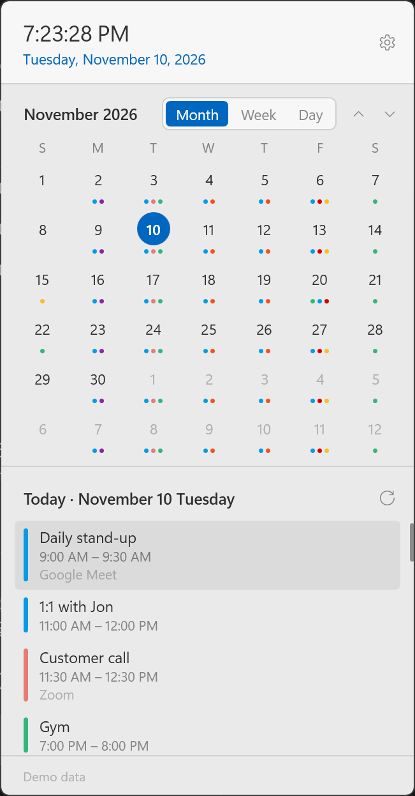
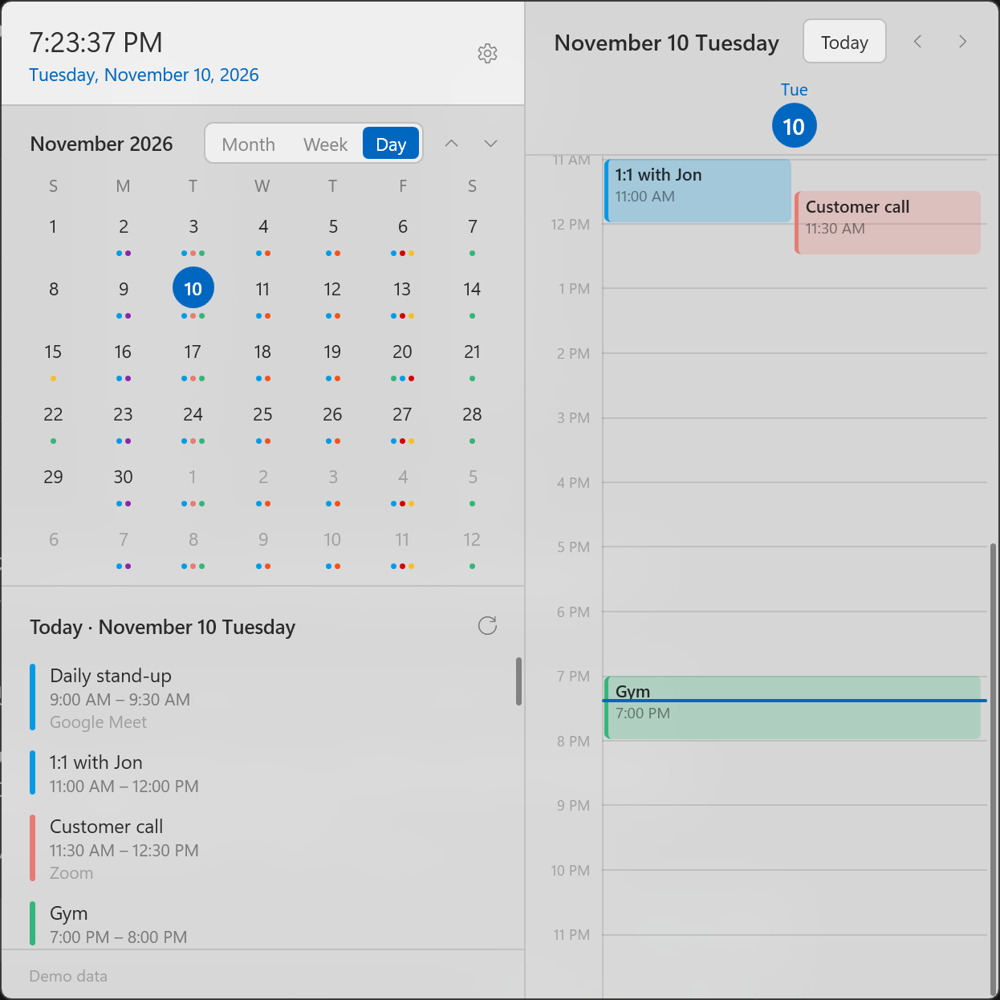
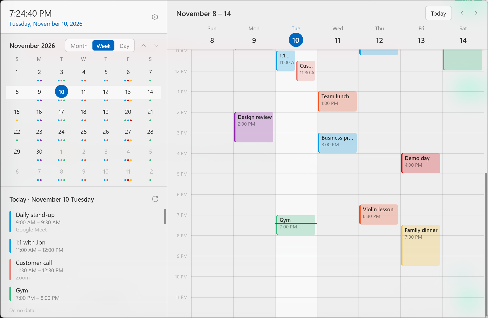

# Dock Calendar

A PowerToys Command Palette extension that puts today's date on the Dock and opens a Windows 11 style calendar flyout when you click it. Events are read from Google Calendar and shown by month, week or day.

- **Month**: a clock, a mini month (days with events get coloured dots) and an agenda for the seven days from the selected day.
- **Week / Day**: the left panel stays and a time grid opens to its right. All-day and multi-day events sit in a strip at the top; overlapping events are drawn side by side.
- The Dock band shows today's date and the next event.
- Follows the Windows light/dark mode and accent colour. The interface is Korean on a Korean system and English everywhere else.
- Events are **read-only**. Clicking one opens it in Google Calendar on the web.

## Screenshots

Taken with the built-in demo data.

| Month | Day |
|---|---|
|  |  |



## Install

Requirements: Windows 11, PowerToys Command Palette 0.9 or newer with the Dock enabled, and the .NET 10 SDK (`10.0.401` or later).

To check the machine and install what is missing (the .NET 10 SDK, Developer Mode, PowerToys), run `./setup.ps1` first; `./setup.ps1 -CheckOnly` only reports. The Windows SDK is not needed to build.

```powershell
./build-and-install.ps1
```

This runs the tests, publishes, registers the package for the current user in development mode and restarts Command Palette. Then add the **Dock Calendar** band under Command Palette **Settings → Dock → Bands**. The extension, its command and its band all share that one name. Enabling the extension does not put the band on the Dock by itself.

To build and test only, run `./build.ps1`.

## Connect Google Calendar

Google requires an OAuth client per app, so you create one once in your own Google Cloud project (free).

1. Create a project in [Google Cloud Console](https://console.cloud.google.com/).
2. Under **APIs & Services → Library**, enable the **Google Calendar API**.
3. Configure the **OAuth consent screen** (user type: External). While its publishing status is **Testing**, you must add your own account as a test user and the sign-in **expires every 7 days**. To keep it, **publish to production**; an app only you use works without verification once you click through the "unverified app" warning.
4. Under **Credentials → Create credentials → OAuth client ID**, create a client of type **Desktop app**.
5. Click the gear at the top right of the flyout, paste the **client ID** and **client secret**, and choose **Sign in with Google**. Approve access in the browser and the flyout is connected.

The only scope requested is `calendar.readonly`. Under **Calendars** in the settings you can turn individual calendars on and off; the default is whatever is ticked in Google Calendar itself.

## Controls

| Action | How |
|---|---|
| Switch view | The Month / Week / Day buttons, or `M` `W` `D` |
| Move between dates | Click a date, `←` `→` (a day), `↑` `↓` (a week), `PageUp` `PageDown` (a month) |
| Change month | The ∧ ∨ buttons above the mini month, or the mouse wheel over it |
| Go to today | Click the clock or the month title, `T` or `Home` |
| Sync now | The refresh button, or `F5` |
| Close | `Esc`, click outside the window, or click the Dock band again |

Events are read again every 10 minutes, and when the flyout opens if the last sync is more than 5 minutes old.

## Run without Command Palette

```powershell
dotnet run --project DockCalendar -c Release -- --demo --pin --view=week
```

- `--demo` shows sample events, with no Google account needed
- `--pin` keeps the flyout open when it loses focus
- `--view=month|week|day` picks the starting view

## Stored data

Everything lives in `%LocalAppData%\DockCalendar` (for the installed package, Windows redirects this to the package's own folder).

- `settings.json`: the client ID, view preferences, and the client secret and refresh token **encrypted with DPAPI**. The encryption is tied to the current Windows user, so a copy of the file is useless elsewhere.
- `cache.json`: the events last read, so the flyout can draw as soon as it opens. Signing out deletes it.

Access tokens are kept in memory only.

## Layout

```text
DockCalendar/
  Calendar/   Event model, cached store, time-grid layout, demo data
  Google/     OAuth sign-in (PKCE + loopback) and the Calendar v3 client
  Ui/         The flyout window (WPF), theming, Win32 interop
  DockCalendarCommandsProvider.cs   Dock band and Command Palette command
DockCalendar.Tests/
  Layout, Google response parsing, store and settings tests
tools/make-icons.ps1   Generates the package icons
```

## Good to know

- The flyout is a window the extension process opens itself, not a Command Palette page. Command Palette detail pages are Adaptive Cards, which cannot draw a calendar grid or a translucent backdrop.
- The window appears beside the screen edge where the Dock is (judged from the mouse pointer). Opened from anywhere else, it appears at the bottom right of the work area.
- The band text is updated in place. Raising `ItemsChanged` would make Command Palette rebuild the whole Dock and reset the other bands.
- The acrylic backdrop needs Windows 11 22H2 or later. On older versions the background is a dark solid colour instead.

## Acknowledgements

The overall structure of this extension (a Command Palette Dock band backed by an out-of-process COM server, and the build and install scripts) is inspired by and adapted from [AI Usage Dock](https://github.com/GChavez0210/AIUsageDock) by Gabriel Chavez.

## License

[PolyForm Noncommercial License 1.0.0](LICENSE.md). You may use, modify and redistribute this software for any noncommercial purpose, as long as you pass on the license terms and the notice below. Commercial use is not permitted. This is a source-available license, not an OSI-approved open source one.

> Required Notice: Copyright (c) 2026 Heesup Yun (https://github.com/heesup/DockCalendar)

Parts adapted from other projects are listed in [THIRD_PARTY_NOTICES.md](THIRD_PARTY_NOTICES.md).
